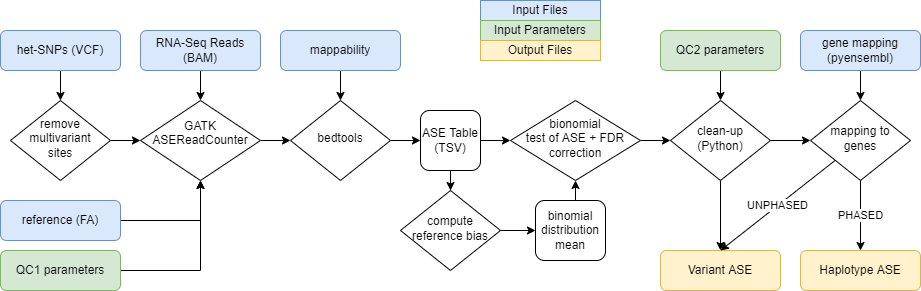

# Pipeline Allele Specific Expression

[](https://github.com/schwarzlab-ccb/pipeline-ase/actions/workflows/ci.yml)
[](https://github.com/schwarzlab-ccb/pipeline-ase/releases/latest)
[](https://github.com/schwarzlab-ccb/pipeline-ase/actions/workflows/docker.yml)
[](./LICENSE)

This is a [Nextflow](https://nextflow.io/) pipeline for analysis of allele-specific expression (ASE) based on RNA-seq data.

## Pipeline

The pipeline processes an alignment file (`BAM`/`SAM`) and its accompanying variant call file (`VCF`) together with their matching reference (`FA`) file. For each SNP, it produces the allele-specific expression ratio and the probability that true ASE is occurring. SAM inputs are converted to coordinate-sorted BAM files before analysis.

If a matching genome annotation (`GTF`) file is provided, the positions are also mapped to genes.

If the data are additionally phased, the haplotype-specific expression for each gene is computed.

The whole pipeline operates as illustrated:



The pipeline can be modified using the following quality control parameters:

* QC1 parameters (applied before ASE read counter)
    * base read depth
    * read mapping quality
    * base calling quality
* QC2 parameters (applied after ASE read counter)
    * read mappability (optional)

## Output

For a file `read_name.bam` we obtain the following outputs:

* `read_name.tsv`: tab separated document detailing the results of the ASE analysis with the following result columns:
    * `ase_ratio`: the RAF adjusted for mean bias towards reference
    * `ref_bias`: the ratio of reference counts to total read counts for the particular base pair
    * `AEI_pval`: the resulting p-value of binomial statistical test
    * `AEI_padj`: the p-value corrected using Benjamini/Hochberg false discovery rate correction. AE is considered significant if `p < 0.05`.
    * [`gene_id`]: if a genome file is provided, maps to an Ensembl gene id
    * [`feature`]: if a genome file is provided, maps to an Ensembl gene feature (exon/intron)
* `read_name.ase.log`: a log file of the ASE calculation and filtering
* `read_name.vaf.png`: a histogram of `ase_ratio` occurrences. In a healthy sample the values should be around 0.5.
* [`read_name.hap.tsv`]: if a genome file is provided and the data are phased, the results of ASE mapped to genes, with the following result columns:
    * `phase_set`: the VCF `PS` value used to orient the haplotypes; genes spanning multiple phase sets produce one row per phase set, and `.` indicates that the VCF supplied no `PS`
    * `positions`: how many positions are covered by a gene
    * `HSE_ratio`: ratio of the first haplotype vs. total
    * `HEI_pval`: the resulting p-value of binomial statistical test for the gene
    * `HEI_padj`: the FDR B/H p-value correction
* [`read_name.gene_annotation.log`]: a log file of the GTF gene-matching calculation
* [`read_name.hap.log`]: a log file of the haplotype-specific expression calculation
* `software_versions.yml`: pipeline, Nextflow, and analysis-tool versions used for the run
* `execution_trace.txt`, `execution_report.html`, and `execution_timeline.html`: Nextflow execution provenance and performance summaries

## Requirements

* Java Runtime
* Nextflow version 21.04.0 or newer
* Conda or Docker

### Nextflow installation

Nextflow can be installed into the repository directly using the command (from the `pipeline-ase` folder):

`wget -qO- https://get.nextflow.io | bash`

### Docker installation

From the root of the repository:

```bash
cd pipeline-ase
docker build . -t pipeline-ase
```

Tagged releases are also published as `ghcr.io/schwarzlab-ccb/pipeline-ase:<version>` and `ghcr.io/schwarzlab-ccb/pipeline-ase:latest`.

### Conda installation

Install Conda or Mamba before using Nextflow's `-with-conda` option. Nextflow creates the pipeline environment from `ase-environment.yaml` on the first run.

`conda-lock.yml` records the exact Linux packages and checksums used by the container build. It can also be installed directly with `conda-lock install --name ase conda-lock.yml`.

## Execution

Run the pipeline with:

`nextflow run pipeline-ase.nf [parameters]`

### Output

By default the results are written to the `./out` folder.

### Test run

Random testing data are provided as a part of the package. The default test execution can be done as following:

* Download the reference data using `sh ./DownloadRefData.sh`.
* Execute the pipeline using either Conda or Docker as follows:
    * [Conda] `nextflow -c tests/integration.config run pipeline-ase.nf -with-conda ase-environment.yaml`
    * [Docker] `nextflow -c tests/integration.config run pipeline-ase.nf -with-docker pipeline-ase`

**NOTE:** The parameters for the execution are stored in `tests/integration.config`. Realistic Git LFS-backed inputs are under `tests/data/integration`; tiny self-contained CI inputs are under `tests/data/smoke`. The smoke test exercises gene annotation, mappability filtering, phased haplotype aggregation, and provenance output without duplicating the integration fixtures.

### Input compatibility checks

Before counting reads, the pipeline verifies that:

* the alignment is readable and contains sequence dictionary entries;
* alignment contig names and lengths are compatible with the reference FASTA;
* every VCF record contig occurs in both the alignment and reference;
* VCF header contig lengths, when present, agree with the alignment and reference; and
* every VCF `REF` allele matches the supplied reference sequence; and
* the selected VCF sample agrees with the alignment's `@RG` `SM` value when one is available.

These checks intentionally stop the workflow early when files use different genome builds, such as an hg38 VCF with an hg19 BAM. Liftover the VCF with a variant-aware tool and validate it against the exact target FASTA before running the pipeline.

### Parameters

#### Mandatory

* `--fa path` reference file either as `.fa` or block-gzipped `.fa.gz`.
* `--bam path` coordinate-sorted BAM files or SAM files. SAM inputs are converted and sorted automatically. This can be a glob pattern (for example, `sample*.bam`); every matching file is analyzed.

**NOTE:** Alignments and variants are matched by name. For example, `sample5.bam` is matched to `sample5.vcf`. If you have a single VCF for all samples, use the `vcf` parameter detailed below.

#### Default

* `--min_depth int` minimum read depth for a position, if not satisfied, the position is discarded, `default=16`,
* `--min_mapping_quality int` minimum mapping quality, if not satisfied, the read is discarded, `default=20`,
* `--min_base_quality int` minimum base call quality, if not satisfied, the base is not counted, `default=10`,

#### Optional

* `--vcf path` variant call files either as `.vcf` or `.vcf.gz`. A single file is shared by all BAMs; multiple files from a glob (e.g. `sample*.vcf`) are matched to BAMs by basename. If the path is not provided, the read files are matched as described above.
* `--out_dir path` a path to a folder where the output is stored
* `--assembly name` genome assembly name used by PyEnsembl. Required when `--gtf` is provided (for example, `GRCh37` or `GRCh38`).
* `--gtf path` GTF annotation used for gene matching. `chr1`/`1` style contig aliases are resolved automatically when possible.
* `--vcf_sample name` sample column to use for haplotype calculations with a multi-sample VCF. If omitted, the BAM-derived name is used when it matches a VCF sample; single-sample VCFs are selected automatically.
* `--mapp path` a mappability file in the [bedGraph format](https://genome.ucsc.edu/goldenPath/help/bedgraph.html), which is used to filter positions in regions of low mappability. Contigs must match the reference.
* `--min_mappability float` a number between `[0-1]` describing the minimum mapping quality if the mappability file is present, bases that have lower than specified mappability are removed, `default=0.05`

Only unique-coordinate, biallelic SNVs are passed to allele counting. Indels, multiallelic records, and duplicate-coordinate records are removed explicitly.

## Reference downloads

Run `bash DownloadRefData.sh` to download the tested reference, annotation, and mappability files into `refs/`. Downloads resume after interruption, retry transient failures, and are checked against a locally recorded SHA-256 digest on subsequent runs. For validation against a trusted published digest, set any of `GRCH38_SHA256`, `GRCH38_BGZIP_SHA256`, `GENCODE_V41_SHA256`, or `UMAP_K50_SHA256` before running the script.

The following human genome files are downloaded:

### Reference

`wget https://storage.googleapis.com/genomics-public-data/references/GRCh38_Verily/GRCh38_Verily_v1.genome.fa`

### Mappability file

`wget https://bismap.hoffmanlab.org/raw/hg38/k50.umap.bedgraph.gz`

### Gene mapping

`wget https://ftp.ebi.ac.uk/pub/databases/gencode/Gencode_human/release_41/gencode.v41.annotation.gtf.gz`

## Contact

Email questions, feature requests and bug reports to **Adam Streck, adam.streck@iccb-cologne.org**.

## License

Pipeline-ASE is available under the [MIT License](./LICENSE).

## Please cite

PCAWG Transcriptome Core Group., Calabrese, C., Davidson, N.R. et al.
Genomic basis for RNA alterations in cancer. Nature 578, 129–136 (2020).
[https://doi.org/10.1038/s41586-020-1970-0](https://www.nature.com/articles/s41586-020-1970-0)

Machine-readable citation metadata are provided in [`CITATION.cff`](./CITATION.cff).

### Further reading

[Tools and best practices for data processing in allelic expression analysis, Castel et al.](https://genomebiology.biomedcentral.com/articles/10.1186/s13059-015-0762-6)

## Development and releases

Install the pinned test dependencies and run the local checks with:

```bash
python -m pip install --requirement requirements-test.txt
ruff check scripts tests
pymarkdown --strict-config scan README.md CHANGELOG.md
python -m compileall -q scripts tests
python -m unittest discover -s tests -v
bash tests/run_smoke_test.sh
```

The smoke test requires Nextflow and the tools in `ase-environment.yaml`. It runs the complete workflow, including optional GTF and mappability branches, against tiny fixtures in a temporary directory.

After changing `ase-environment.yaml`, regenerate and verify the Linux lockfile with:

```bash
conda-lock lock -f ase-environment.yaml -p linux-64 --lockfile conda-lock.yml
conda-lock lock --check-input-hash -f ase-environment.yaml -p linux-64 --lockfile conda-lock.yml
```

The project follows [Semantic Versioning](https://semver.org/). The current
version is stored in `VERSION` and repeated in the Nextflow manifest; automated
tests ensure they stay synchronized. Container builds also receive the version
as an OCI image label. Update both version values and `CHANGELOG.md` in a release
commit, then push a matching tag such as `v1.0.0`. After all tests and a clean
container build, GitHub Actions publishes the versioned container to GHCR and creates the corresponding release automatically.
